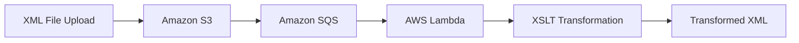
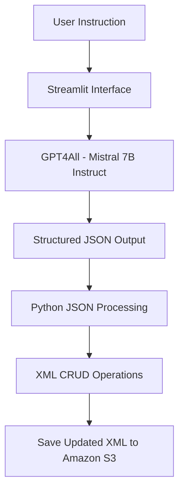

# AWS XML Transformer & AI-Powered XML Editor

An event-driven cloud automation and AI-powered XML management project developed during my Cloud Developer internship at NTT DATA.

## 📌 Project Overview

This project combines AWS cloud services, infrastructure automation, and Large Language Models (LLMs) to automate XML data transformation and simplify product data management through natural language instructions.

The project consists of two main components that can operate independently or together.

## ☁️ 1. AWS XML Transformer

An automated XML transformation pipeline built using AWS services and XSLT.

### Architecture



### Key Features

- Event-driven cloud architecture
- Automated XML file processing
- XML transformation using XSLT
- Serverless processing with AWS Lambda
- Asynchronous message processing with Amazon SQS
- Infrastructure as Code using AWS CloudFormation

## 🤖 2. AI-Powered XML Editor

A Streamlit-based product management application that integrates a locally running Large Language Model with Amazon S3.

The application allows users to manage XML product data through both manual operations and natural language instructions.

### Key Features

- Local LLM integration using GPT4All and Mistral 7B Instruct
- Natural language-based product management
- Structured JSON generation from user instructions
- Create, Read, Update, and Delete (CRUD) operations
- Automatic retrieval of the latest XML file from Amazon S3
- XML parsing and manipulation using Python ElementTree
- Saving updated XML data directly to Amazon S3
- Interactive Streamlit user interface
- Basic exception handling and user feedback

### AI Processing Workflow



### Example Use Case

A user can enter a natural language instruction such as:

> Add a product named Wireless Mouse with a price of 25, stock of 100, and brand Logitech.

The local LLM generates a structured JSON response:

```json
{
  "action": "add",
  "product": {
    "name": "Wireless Mouse",
    "price": 25,
    "stock": 100,
    "brand": "Logitech",
    "features": []
  }
}
```

The application processes the JSON response, creates the corresponding XML product element, and saves the updated XML file to Amazon S3.

## 🛠️ Technologies Used

| Technology | Purpose |
|---|---|
| Python | Application development and business logic |
| Amazon S3 | XML file storage and retrieval |
| Amazon SQS | Asynchronous message queuing |
| AWS Lambda | Serverless processing |
| AWS CloudFormation | Infrastructure as Code |
| Boto3 | AWS SDK integration |
| XML & XSLT | Structured data transformation |
| ElementTree | XML parsing and manipulation |
| JSON | Structured LLM output processing |
| Streamlit | Interactive user interface |
| GPT4All | Local LLM integration |
| Mistral 7B Instruct | Natural language processing |

## 📂 Repository Structure

```text
aws-xml-transformer/
├── aws-xml-transformer/
│   ├── template.yaml
│   └── lambda/
├── app.py
└── README.md
```

## 💻 My Contributions

- Developed an event-driven XML processing workflow using AWS services.
- Implemented XML transformation logic using Python and XSLT.
- Worked with AWS CloudFormation for infrastructure automation.
- Developed an interactive product management application using Streamlit.
- Integrated a locally running LLM using GPT4All and Mistral 7B Instruct.
- Designed prompts to generate structured JSON responses from natural language instructions.
- Implemented XML-based CRUD operations.
- Integrated Amazon S3 for automated XML file retrieval and storage.
- Combined cloud automation and generative AI within a single project.

## 🎯 Skills Demonstrated

- Python Development
- Cloud Computing
- Serverless Architecture
- Event-Driven Systems
- Infrastructure as Code
- Generative AI Integration
- Prompt Engineering
- Structured LLM Output Processing
- XML and JSON Data Processing
- User Interface Development
- AWS SDK Integration

## 📈 Potential Improvements

- Environment-based configuration management
- JSON schema validation for LLM-generated responses
- Improved error handling and logging
- User confirmation before AI-generated modifications
- Automated unit and integration testing
- Improved product ID management
- XML versioning and rollback support

## 📌 Project Status

Internship project demonstrating cloud automation, local LLM integration, and AI-assisted XML data management.

## 👩‍💻 Developer

Eda Yaygılı – Software Engineer
